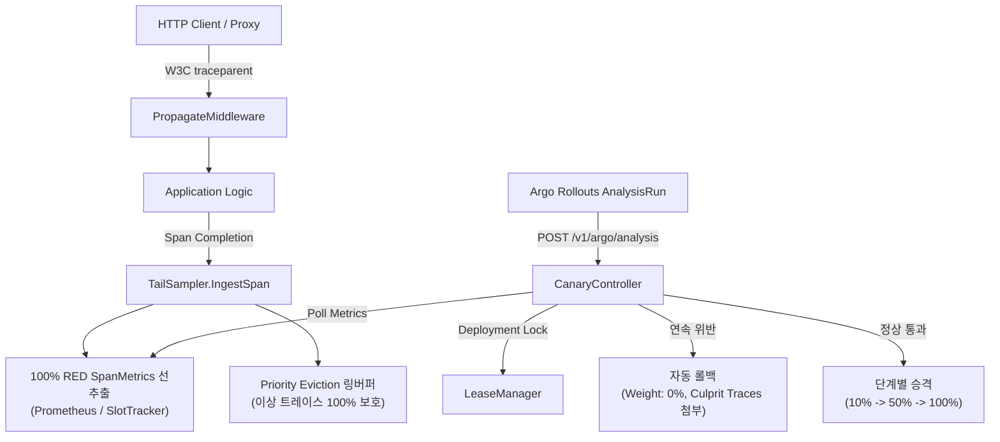

# rolltrace

카나리 배포 환경에서 W3C Trace Context 전파, OTLP JSON 스팬 수집, Tail-based 샘플링, SLO 기반 자동 롤백을 수행하는 Go 관측성 데몬입니다. `net/http` 미들웨어로 애플리케이션에 붙이거나 OTLP/JSON과 Argo Rollouts AnalysisRun 웹훅을 받는 독립 데몬(`cmd/rolltrace`)으로 실행할 수 있습니다.

## 수집 및 롤백 파이프라인



Head-based 샘플링(예: 진입 시 5% 확률 추출)은 정작 원인 분석이 필요한 `5xx` 에러나 고지연 트레이스의 95%를 버리고 에러율 모수를 왜곡합니다. `rolltrace`는 샘플링 전에 전수 스팬에서 RED(요청 수, 에러율, 지연 시간) 지표를 먼저 집계한 뒤, 이상 트레이스를 100% 보존하는 Tail-based 샘플러와 최소 표본수 게이트 기반 카나리 컨트롤러를 연결해 이 문제를 해결합니다.

## 패키지 구성 및 설계

```text
pkg/rolltrace/
├── config.go         샘플러, 카나리 SLO, 배포 리스 설정 및 유효성 검사
├── tracecontext.go   W3C traceparent 파서/생성기 및 HTTP 컨텍스트 전파 미들웨어
├── tailsampler.go    100% RED SpanMetrics 선추출, xxhash Tail-based 샘플러, Priority Eviction 링버퍼
├── lease.go          서비스별 원자적 배포 리스(TTL, 멱등 갱신, 소유자 검증)
├── canary.go         최소 표본수 게이트 기반 SLO 평가기 및 단계별 승격, 자동 롤백 상태 머신
├── server.go         OTLP/JSON 수집, 롤아웃 제어, Argo Rollouts 웹훅, Prometheus 핸들러
└── server_test.go    단위, 통합 및 120 고루틴 동시성 경합 검증
cmd/rolltrace/
└── main.go           signal.NotifyContext 기반 독립 실행 데몬
```

### 전수 RED SpanMetrics 선추출과 Tail-based 보존 (`tailsampler.go`)
샘플링 판정 전에 모든 스팬에서 슬롯(`stable`, `canary`)별 요청 카운터, 에러 카운터, 지연 시간 히스토그램을 먼저 갱신합니다. 이후 HTTP 상태 코드가 `ErrorStatusThreshold`(기본 500) 이상이거나 에러 플래그, 지연 초과(`LatencyThresholdMs`, 기본 500ms), 서킷 폴백(`FallbackUsed: true`)에 해당하면 `DecisionKeepAnomaly`로 전량 보존하고, 정상 트레이스만 `xxhash/v2` 해시로 `BaseSampleRate`(기본 5%) 비율만큼 남깁니다. `MaxBufferedTraces`(기본 2,048개) 포화 시에는 가장 오래된 정상 트레이스부터 축출하는 Priority Eviction 링버퍼로 이상 트레이스를 보호합니다.

### 최소 표본수 게이트와 원자적 배포 리스 (`canary.go`, `lease.go`)
카나리 슬롯의 누적 요청 수가 `MinSampleCount`(기본 20건)에 도달하기 전에는 에러율이 높아도 `ActionHold`(`ReasonInsufficientSamples`)를 유지해 초반 소수 요청에 의한 오탐 롤백을 막습니다. 표본이 모인 뒤 연속 `ConsecutiveBreaches`(기본 2회) 이상 SLO를 위반하면 가중치를 `0%`로 되돌리고 원인 트레이스 ID(`culprit_trace_ids`)를 첨부합니다. 롤아웃 중에는 `LeaseManager`가 서비스별 리스를 선점해 타 워커 충돌 시 `ErrLeaseHeld`(`409 Conflict`)를 반환합니다.

## CLI 플래그 및 실행

```sh
make build

./bin/rolltrace \
  -http-addr :8083 \
  -service order-api \
  -latency-threshold 500 \
  -error-threshold 500 \
  -base-sample-rate 0.05 \
  -max-buffered-traces 2048 \
  -min-sample-count 20 \
  -consecutive-breaches 2
```

| Flag | Default | 설명 |
| :--- | :--- | :--- |
| `-http-addr` (`-listen`) | `:8080` | HTTP 서버 수신 주소 및 포트 |
| `-service` | `rolltrace` | 기본 서비스 식별자 |
| `-latency-threshold` | `500` | 이상 트레이스 판정 지연 시간 임계값 (ms) |
| `-error-threshold` | `500` | 이상 트레이스 판정 HTTP 상태 코드 기준 |
| `-base-sample-rate` | `0.05` | 정상 트레이스 해시 샘플링 비율 (`0.0` ~ `1.0`) |
| `-max-buffered-traces` | `2048` | 메모리에 보존할 최대 트레이스 수 |
| `-min-sample-count` | `20` | SLO 평가 전 요구되는 최소 요청 표본 수 |
| `-consecutive-breaches` | `2` | 자동 롤백을 발동하는 연속 SLO 위반 횟수 |

### HTTP 엔드포인트 및 Argo Rollouts 연동

| Endpoint | Method | 설명 |
| :--- | :--- | :--- |
| `/v1/traces` | `POST` | OTLP JSON(`resourceSpans`) 또는 단일/배열 스팬 JSON 수집 |
| `/v1/traces/{traceID}` | `GET` | 보존된 트레이스의 전체 스팬 목록 조회 |
| `/v1/rollouts/start` | `POST` | 서비스 카나리 롤아웃 시작 및 배포 리스 선점 |
| `/v1/rollouts/evaluate` | `POST` | 현재 카나리 슬롯 메트릭과 SLO 비교 판정 |
| `/v1/argo/analysis` | `POST` | Argo Rollouts `AnalysisRun` 웹훅 결과(`Successful`, `Running`, `Failed`) 반환 |
| `/healthz` | `GET` | 데몬 생존 상태 및 가동 시간 반환 |
| `/metrics` | `GET` | Prometheus 메트릭 노출 |

```bash
curl -X POST http://localhost:8083/v1/rollouts/start \
  -H "Content-Type: application/json" \
  -d '{"service": "checkout", "version": "v2.1.0", "holder_id": "argo-rollout-worker"}'

curl -X POST "http://localhost:8083/v1/argo/analysis?service=checkout"
```

```yaml
apiVersion: argoproj.io/v1alpha1
kind: AnalysisTemplate
metadata:
  name: rolltrace-slo-gate
spec:
  metrics:
  - name: canary-health
    interval: 10s
    successCondition: result.phase == "Successful" || result.phase == "Running"
    failureLimit: 0
    provider:
      web:
        url: "http://rolltrace.observability.svc:8083/v1/argo/analysis?service=checkout"
        jsonPath: "{$.phase}"
```

## 테스트 및 제약사항

```sh
go test ./...
go test -race ./...
```

`server_test.go`에서 W3C `traceparent` 전파, 이상 트레이스 100% 보존 및 Priority Eviction, 배포 리스 충돌, 최소 표본수 게이트, 연속 위반 롤백, 단계별 승격(`10% -> 50% -> 100%`), 120 고루틴 동시성 경합을 검증합니다.

트레이스 링버퍼와 배포 리스 상태는 단일 프로세스 인메모리 뮤텍스로 관리하므로 수평 확장 시에는 동일 `trace_id` 라우팅이나 외부 공유 저장소가 필요합니다. 또한 `/v1/traces`는 OTLP JSON(`resourceSpans`) 및 스팬 JSON을 처리하며, gRPC OTLP Protobuf 바이너리 스트림은 앞단 OpenTelemetry Collector 변환이 필요합니다.
